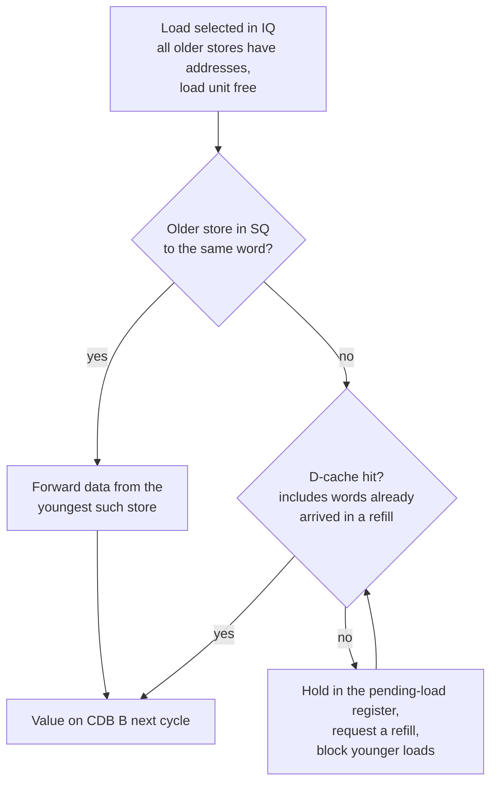

# WISC-S25 Processor — Project Description

This document describes both processors in this repository, as they are implemented in the RTL:

1. **The five-stage pipelined core** (`project_working_directory/`): the ECE/CS 552 phase-3 design.
   It is a classic IF/ID/EX/MEM/WB pipeline with forwarding, branches resolved in decode, and
   2-way set-associative instruction and data caches.
2. **The out-of-order core** (`ooo_core/`): the same ISA and top-level interface, rebuilt around
   - a reorder buffer, register renaming and a unified issue queue;
   - a store queue with store-to-load forwarding;
   - a choice of seven branch predictors;
   - a memory system with critical-word-first refills and next-line prefetching.

Both cores run the same WISC-S25 programs. A Python golden model checks the out-of-order core
instruction by instruction. On the programs the five-stage core runs correctly, the out-of-order
core is 1.60x faster (geometric mean).

Diagrams are plain text so they render everywhere. A few flowcharts use Mermaid; GitHub renders
those automatically.

## Contents

- [Part 0 — The WISC-S25 ISA](#part-0--the-wisc-s25-isa)
- [Part I — The five-stage pipelined core](#part-i--the-five-stage-pipelined-core)
- [Part II — The out-of-order core](#part-ii--the-out-of-order-core)
- [Part III — Verification and tooling](#part-iii--verification-and-tooling)
- [Part IV — Results](#part-iv--results)
- [Part V — Side-by-side comparison](#part-v--side-by-side-comparison)
- [Appendix — File index](#appendix--file-index)

---

# Part 0 — The WISC-S25 ISA

## Programmer-visible state

| State | Description |
|---|---|
| `R0`–`R15` | 16 general-purpose 16-bit registers. `R0` always reads 0, and writes to it are discarded. |
| `Z`, `N`, `V` | Zero, negative and overflow flags. Only the compute instructions set them (see below). |
| `PC` | 16-bit byte address of the current instruction; instructions are 16 bits, so `PC` advances by 2. |
| Memory | 64 K × 16-bit words, byte-addressed (address bit 0 is ignored). Code and data share one address space. |

## Instruction formats

```text
  15     12 11      8 7       4 3       0
 +---------+---------+---------+---------+
 | opcode  |   rd    |   rs    |   rt    |   ADD SUB XOR RED PADDSB      (register-register)
 +---------+---------+---------+---------+
 | opcode  |   rd    |   rs    |  imm4   |   SLL SRA ROR                 (imm4 = shift amount 0..15)
 +---------+---------+---------+---------+
 | opcode  |   rt    |   rs    |  off4   |   LW  (rt <- mem)   SW  (rt -> mem); off4 is signed, in words
 +---------+---------+---------+---------+
 | opcode  |   rd    |       imm8        |   LLB LHB
 +---------+------+--+-------------------+
 | opcode  | cond |        imm9          |   B    target = PC + 2 + (sext(imm9) << 1)
 +---------+------+--+---------+---------+
 | opcode  | cond | x|   rs    |  xxxx   |   BR   target = rs
 +---------+------+--+---------+---------+
 | opcode  |   rd    |     xxxxxxxx      |   PCS  rd = PC + 2
 +---------+---------+-------------------+
 |  1111   |          xxxxxxxxxxxx       |   HLT
 +---------+-----------------------------+
```

## Instructions

| Opcode | Mnemonic | Operation | Flags written |
|---|---|---|---|
| `0000` | `ADD rd, rs, rt` | `rd = sat16(rs + rt)` (saturates to `0x7FFF` / `0x8000`) | Z N V |
| `0001` | `SUB rd, rs, rt` | `rd = sat16(rs - rt)` | Z N V |
| `0010` | `XOR rd, rs, rt` | `rd = rs ^ rt` | Z |
| `0011` | `RED rd, rs, rt` | reduction add (see [arithmetic notes](#arithmetic-notes)) | — |
| `0100` | `SLL rd, rs, imm4` | shift left logical | Z |
| `0101` | `SRA rd, rs, imm4` | shift right arithmetic | Z |
| `0110` | `ROR rd, rs, imm4` | rotate right | Z |
| `0111` | `PADDSB rd, rs, rt` | four independent 4-bit saturating adds (each clamped to −8..7) | — |
| `1000` | `LW rt, rs, off4` | `rt = M[(rs & 0xFFFE) + (sext(off4) << 1)]` | — |
| `1001` | `SW rt, rs, off4` | `M[(rs & 0xFFFE) + (sext(off4) << 1)] = rt` | — |
| `1010` | `LLB rd, imm8` | `rd = (rd & 0xFF00) \| imm8` | — |
| `1011` | `LHB rd, imm8` | `rd = (rd & 0x00FF) \| (imm8 << 8)` | — |
| `1100` | `B cond, label` | if `cond`: `PC = PC + 2 + (sext(imm9) << 1)` | — |
| `1101` | `BR cond, rs` | if `cond`: `PC = rs` | — |
| `1110` | `PCS rd` | `rd = PC + 2` (with `BR`, this forms call/return) | — |
| `1111` | `HLT` | stop; the PC no longer advances | — |

`LLB` and `LHB` keep half of the old `rd`, so they read `rd` as a source as well as writing it.

## Condition codes

| `cond` | Name | Taken when | Flags read |
|---|---|---|---|
| `000` | NEQ | Z = 0 | Z |
| `001` | EQ | Z = 1 | Z |
| `010` | GT | Z = 0 and N = 0 | Z, N |
| `011` | LT | N = 1 | N |
| `100` | GTE | Z = 1 or N = 0 | Z, N |
| `101` | LTE | N = 1 or Z = 1 | Z, N |
| `110` | OVFL | V = 1 | V |
| `111` | UNCOND | always | — |

## Arithmetic notes

These are the exact semantics both cores implement, since both use the same arithmetic modules,
and the golden model reproduces them.

- **Saturation.** `ADD` and `SUB` clamp to the signed 16-bit range, and V reports that saturation
  happened.
- **PADDSB.** Each 4-bit lane is added as two signed 4-bit numbers, and the result is clamped to
  `-8..7`.
- **RED** (as built by `RED.v`):
  - Each of the four nibble pairs `a[4i+3:4i] + b[4i+3:4i]` is added as unsigned 4-bit numbers,
    giving a 5-bit result with the carry as bit 4.
  - Each 5-bit result is read as a signed value.
  - The four values are summed, and the 8-bit total is sign-extended to 16 bits.
- **Shifts** use the 4-bit immediate. `ROR` by 0 returns the input unchanged.

## Assembler conveniences

The project's assembler, `ooo_core/tools/wisc.py`, adds labels, comments (`//`, `#`, `;`),
directives `.org`, `.word` (a number or a label) and `.fill`, and these pseudo-ops:

| Pseudo-op | Expands to | Why |
|---|---|---|
| `NOP` | `PADDSB R0, R0, R0` | writes nothing and touches no flags |
| `MOV rd, rs` | `PADDSB rd, rs, R0` | a copy that does not change flags (rs + 0, so no lane can saturate) |
| `CMP rs, rt` | `SUB R0, rs, rt` | sets Z/N/V without writing a register |
| `LI rd, value` | `LLB rd, lo(value)` + `LHB rd, hi(value)` | load a 16-bit constant (labels allowed) |

---

# Part I — The five-stage pipelined core

Source: `project_working_directory/`. Top level: `cpu.v`. Testbench: `cpu_ptb` in
`project-phase3-testbench.v`.

## I.1 Overview

```text
                         branch taken: next_PC = target, flush the instruction in IF
            +------------------------------------------------------------+
            |                                                            |
            v                                                            |
       +---------+  IF/ID  +------------------+  ID/EX  +-------------+  EX/MEM  +-------------+  MEM/WB  +-----------+
  PC ->|   IF    |-------->|       ID         |-------->|     EX      |--------->|     MEM     |--------->|    WB     |
       | I-cache |         | ControlSignal    |         | ALU         |          | D-cache     |          | RF write  |
       | PC + 2  |         | RegisterFile rd  |         | LLB/LHB     |          | LW / SW     |          | flag regs |
       +---------+         | pc_control:      |         | address gen |          |             |          | (Z, N, V) |
                           |  branch resolve  |         +-------------+          +-------------+          +-----------+
                           +------------------+               ^    ^                 |      ^                  |
                                  ^    ^                      |    |  EX/MEM -> EX   |      | MEM/WB -> MEM    |
                                  |    |                      |    +-----------------+      | (store data)     |
                                  |    |                      |          MEM/WB -> EX       |                  |
                                  |    |                      +-----------------------------+------------------+
                                  |    +-- register-file write-before-read bypass (WB -> ID) -----------------+
                                  +------- flag bypass for branches (WB -> ID) --------------------------------+

       I-cache miss: PC holds, a NOP (0xE000 = PCS R0) is sent into ID.
       D-cache miss: every pipeline register holds (the whole pipeline freezes).
```

**Register naming in `cpu.v`.** Signals are named after the pipeline register they come out of.
For example, `ID_EX_*` is the decode stage's logic, which feeds the ID/EX register. In stage terms:

| Stage | Signal prefix in `cpu.v` | What happens there |
|---|---|---|
| IF | `IF_ID_*` | PC, I-cache read, PC + 2 |
| ID | `ID_EX_*` | decode, register read, branch resolution, hazard detection |
| EX | `EX_MEM_*` | forwarding muxes, ALU, LLB/LHB byte merge, address generation |
| MEM | `MEM_WB_*` | D-cache access, store-data forwarding |
| WB | `WB_*` | register-file write, flag write, `hlt` |

## I.2 Stage by stage

**IF.** The PC register is built from 16 `dff`s. `CLA_16b` computes `PC + 2`. The I-cache is read
combinationally. The PC holds when:
- a data or flag hazard stalls decode;
- the D-cache or I-cache is missing;
- an `HLT` is anywhere in ID through WB.

On an I-cache miss, IF sends `0xE000` (`PCS R0`, which has no effect) into the IF/ID register
instead of the instruction.

**ID.** `ControlSignal` (`controlsignal.v`) decodes the opcode. Its control signals:

| Opcode | RegWrite | ALUSrc | MemRead / MemWrite | MemtoReg | other |
|---|---|---|---|---|---|
| ADD, SUB, XOR, RED, PADDSB | 1 | 0 | – | 0 | ALUOp = op |
| SLL, SRA, ROR | 1 | 1 (imm4) | – | 0 | ALUOp = op |
| LW | 1 | 1 | Read | 1 | `DMEM_en`, ALUOp = ADD (address) |
| SW | 0 | 1 | Write | – | `DMEM_en`, `RegSel_rt` (data register = bits 11:8) |
| LLB / LHB | 1 | – | – | 0 | `LB_result_sel`, `RegSel_rs` (read rd), `LB_mode` = low/high |
| B / BR | 0 | – | – | – | `Branch`; BR also `bLabel_sel` (target from register) |
| PCS | 1 | – | – | – | `PC_save` (write PC + 2) |
| HLT | 0 | – | – | – | `Hlt` |

The register file has two read ports. `pc_control.v` evaluates the condition code against the
flags and produces the next PC:
- If the branch is not taken, the next PC is PC + 2.
- A taken `B` goes to `PC + 2 + (imm9 << 1)`.
- A taken `BR` goes to `Rs`.

The policy is predict not-taken. A taken branch resets the IF/ID register, which squashes the one
instruction fetched behind it, and redirects the PC. A taken branch therefore costs one bubble.

**EX.** Forwarding muxes select each ALU operand from:
- the ID/EX register;
- the EX/MEM register (*EX→EX* forwarding);
- the MEM/WB register (*MEM→EX* forwarding).

The ALU (`ALU.v`) selects one of the arithmetic units (`ALUOp`). For loads and stores, the base is
masked with `0xFFFE` and the offset shifted left by 1, and the ALU's ADD computes the address.
`LLB`/`LHB` bypass the ALU: a byte-merge path keeps one half of `rd` and inserts `imm8`.

**MEM.** LW/SW access the D-cache. If the store's data register is written by a load that is
in WB this cycle, the data is forwarded from WB (*MEM→MEM* forwarding).

**WB.** The write-back value is `PC+2` for PCS, the loaded word for LW, and the EX result
otherwise. Three `dff`s hold Z, N and V. They are written by ADD, SUB, XOR, SLL, SRA and ROR,
selected in hardware as opcodes with `op[3] = 0` and `op[1:0] != 11`. `hlt` is the HLT flag in WB.

## I.3 Hazards

| Hazard | Detection (in ID) | Resolution |
|---|---|---|
| ALU result needed by the next instruction | rd of the instruction in MEM = source in EX | EX/MEM → EX forwarding |
| Result two instructions back | rd of the instruction in WB = source in EX | MEM/WB → EX forwarding |
| Result being written this cycle | WB writes the register ID is reading | register-file write-before-read bypass |
| Load followed by a dependent | instruction in EX is a load and its rd = a source in ID | stall IF/ID one cycle, then forward |
| Load followed by a store of that value | load in WB, store in MEM, same register | MEM/WB → MEM forwarding (no stall) |
| Branch needs flags still being computed | a flag-setting instruction is in EX or MEM, and the condition reads that flag | stall the branch in ID |
| Branch needs flags being written now | a flag-setting instruction is in WB | flag bypass from WB |
| `BR` needs a register still being computed | Rs = rd of the instruction in EX or MEM | stall in ID |
| Taken branch | resolved in ID | flush the one fetched instruction (1 bubble) |
| I-cache miss | `instr_miss_stall` | hold PC, send a NOP into ID |
| D-cache miss | `data_miss_stall` | freeze every pipeline register |

Example timing (each column is a cycle):

```text
                      c1   c2   c3   c4   c5   c6   c7
ADD  R1, R2, R3       IF   ID   EX   MEM  WB
SUB  R4, R1, R5            IF   ID   EX   MEM  WB             R1 forwarded EX/MEM -> EX in c4

LW   R1, R2, 0        IF   ID   EX   MEM  WB
ADD  R4, R1, R5            IF   ID   ID   EX   MEM  WB        load-use: one stall, then MEM/WB -> EX

SUB  R0, R1, R2       IF   ID   EX   MEM  WB
B    EQ, target            IF   ID   ID   ID                  stalls while SUB is in EX and MEM; resolves in c5 via the WB flag bypass
<fall-through>                  IF   IF   IF                  held in IF during the stall; flushed if the branch is taken
```

## I.4 Arithmetic units

All arithmetic is built structurally from carry-lookahead adders. The out-of-order core reuses
these same modules.

| Module | Function |
|---|---|
| `CLA_4b.v` | 4-bit carry-lookahead adder with P/G outputs and signed-overflow detection |
| `CLA_16b.v` | 16-bit adder from four `CLA_4b`s plus a second-level lookahead unit; used for the ALU, PC + 2, branch targets and the miss handler's address counter |
| `Adder_ALU.v` | saturating 16-bit add: on overflow, the result is `0x7FFF` (positive) or `0x8000` (negative) |
| `Subtractor.v` | saturating 16-bit subtract (`a + ~b + 1`) |
| `XOR.v` | bitwise XOR, Z only |
| `PSA_16bit.v` | PADDSB: four `CLA_4b`s with per-lane saturation |
| `RED.v` | three-level adder tree (4 × 4-bit, 2 × 8-bit, 1 × 8-bit), sign-extended |
| `Shifter.v` | SLL / SRA as a 2-level shifter (shift by 0–3, then by 0/4/8/12) |
| `Rotater.v` | ROR built the same way |
| `Shifter_ALU.v` | selects shift vs rotate by `mode` |
| `ALU.v` | instantiates all of the above and multiplexes the result and flags by `ALUOp` |

## I.5 Register file

`register_file.v` builds 16 registers out of `BitCell`s (`bit_cell.v`). Each cell has one
write port and two read bitlines, and the read ports are driven through tri-state bitlines
selected by one-hot decoders (`read_decoder_4_16.v`, `write_decoder_4_16.v`). Reads of `R0`
return 0. When WB writes the register that ID is reading in the same cycle, the new value is
passed straight through (write-before-read). Writes are suppressed while the D-cache is
missing.

## I.6 Memory hierarchy

```text
                 +-----------------------------------------------------------------+
                 |                        unified_memory.v                         |
   PC ---------->|  I_cache.v   2 KB, 2-way, 64 sets x 8 words       instr -------->|--> IF
                 |       |  miss                                                   |
                 |       v                                                         |
                 |  cache_memory_bridge.v  (arbiter: I-cache miss first)           |
                 |       |            \                                            |
                 |       v             \  SW hit: write-through                    |
                 |  cache_miss_handler.v --> memory4c.v (64K x 16, 4-cycle read)   |
                 |       ^                                                         |
                 |       |  miss                                                   |
   addr, data -->|  D_cache.v   2 KB, 2-way, write-through, write-allocate         |--> MEM
                 +-----------------------------------------------------------------+
```

**Cache organisation.** The I-cache and D-cache have the same structure: 2 KB, 2-way
set-associative, 64 sets, 16-byte lines of eight 16-bit words.

```text
  address:  | 15 ......... 10 | 9 ....... 4 | 3 ... 1 | 0 |
            |   tag (6 bits)  | set (6 bits)| word (3)| x |
```

- `MetaDataArray.v` holds one byte per way and set: `{tag[5:0], valid, LRU}`.
- `DataArray.v` holds 64 blocks × 8 words of `dff` cells.
- The set and word are selected one-hot by `decoder_6_64.v` and `decoder_3_8.v`.
- A hit needs a valid way with a matching tag.
- On a miss, the victim way is chosen from the LRU bits.
- A shift register steps the word-enable through the 8 words as refill data arrives, and the tag
  is written when the line is complete.

**D-cache write policy.** The D-cache is write-through and write-allocate. A store hit writes the
cache word and main memory in the same cycle. A store miss first refills the line, then writes.

**Miss handler** (`cache_miss_handler.v`). A 12-bit shift register tracks one refill:

```text
  cycle (from first read): 0  1  2  3  4  5  6  7  8  9  10 11
  memory read issued:      w0 w1 w2 w3 w4 w5 w6 w7
  data returns:                        w0 w1 w2 w3 w4 w5 w6 w7   (memory4c: 4-cycle pipelined reads)
  tag/valid written:                                         X
```

The refill starts at the beginning of the line (`addr & 0xFFF0`). Counting the cycle in which the
miss is detected, the pipeline stalls for about 13 cycles per miss.

**Arbitration** (`cache_memory_bridge.v`). One handler serves both caches. If both miss at once,
the I-cache is served first, and the D-cache miss waits until no instruction refill is in flight.

**Main memory** (`memory4c.v`, course-provided):
- 64 K × 16-bit words.
- Writes take 1 cycle; reads take 4 cycles, pipelined, so one read can be issued per cycle.
- At reset it loads the image named by the `+IMG=<file>` plusarg, defaulting to
  `loadfile_test4.img`.

## I.7 Testbench and outputs

`project-phase3-testbench.v` (`cpu_ptb`) uses a 100-time-unit clock and holds reset for 201
units. It writes:
- `verilogsim.plog`: per-cycle PC, instruction, register and memory activity, plus a summary;
- `verilogsim.ptrace`: an architectural trace of `REG`, `LOAD` and `STORE` events;
- `dump.vcd`: a waveform.

The summary reports `sim_cycles`, `inst_count` and the I-/D-cache hit and request counts. Saved
reference runs:

| Test | Cycles | Instructions | I-cache hits / requests | D-cache hits / requests |
|---|---:|---:|---:|---:|
| TEST1 | 44 | 38 | 10 / 12 | 0 / 0 |
| TEST2 | 54 | 47 | 11 / 13 | 1 / 2 |
| TEST3 | 55 | 45 | 20 / 22 | 0 / 0 |
| TEST4 | 365 | 242 | 170 / 176 | 30 / 32 |

The testbench's `inst_count` also counts cache-refill activity, so it overstates the number of
instructions. For the IPC comparisons in Part IV, the instruction count comes from the golden
model instead.

## I.8 Where the five-stage core differs from the ISA

These came up while cross-checking against the golden model:

- **N and V after XOR and the shifts.** The flag registers are written for XOR, SLL, SRA and ROR
  as well as ADD/SUB. But `ALU.v` doesn't assign `ovfl`/`sign` for those operations, so those
  outputs hold their last values (a latch). The stale N/V can come from any earlier ADD-type
  operation, including a load or store's address add. The ISA says these instructions write
  only Z.
- **Address arithmetic.** LW/SW addresses go through the saturating `Adder_ALU`, so a base +
  offset that crosses `0x7FFF`/`0x8000` saturates instead of wrapping.

Because of these, the five-stage core ends with different register values on some of the newer
test programs, and it never halts on `flags_branches`. Which deviation causes each mismatch
hasn't been traced.

---

# Part II — The out-of-order core

Source: `ooo_core/rtl/`. Top level: `cpu.v`, with the same ports as the five-stage core:
`cpu(clk, rst_n, hlt, pc)`.

## II.1 Design goals

- **Out-of-order execution** with precise state: instructions run as soon as their operands are
  ready and retire in program order through a reorder buffer.
- **Register renaming** of R1–R15 and the flags, which removes WAR and WAW hazards.
- **Better branch prediction** than predict-not-taken: bimodal, gshare, tournament, perceptron
  and TAGE-lite, selectable by a parameter.
- **Single-wide**: fetch, dispatch and commit handle one instruction per cycle (a deliberate
  choice to avoid wide fetch). Several functional units can still issue in the same cycle.
- **Reuse**: the phase-3 arithmetic blocks and the course `memory4c` main memory are used
  unchanged.
- **Measurable**: every optimization is a parameter, so it can be turned off and compared.

## II.2 Top-level block diagram

```text
 +-------------------------------- FRONT END (frontend.v) -------------------------------------+
 |                                                                                              |
 |  fetch_pc --> I-cache (2 KB 2-way) --> predecode --> next-PC select --> IFQ (4 entries)      |
 |     ^             |                      |  B: target = PC+2+imm   {pc, instr,               |
 |     |             | miss                 |  BR: BTB (16 entries)    predicted next PC,       |
 |     |             v                      v                          GHR snapshot}           |
 |     |        mem_system          direction predictor (BP_TYPE 0..6)        |                 |
 |     |                            + speculative 16-bit GHR                  |                 |
 +-----|-----------------------------------------------------------------------|-----------------+
       | redirect (mispredict: PC, repaired GHR)                               v
       |                                                  +---------------------------------------+
       |                                                  | DECODE / RENAME / DISPATCH (cpu.v)    |
       |                                                  |  decoder.v: FU class, sources, dests  |
       |                                                  |  map table: R1..R15, Z, NV -> ROB tag |
       |                                                  |  operand read: ARF / ROB / CDB        |
       |                                                  |  PCS, HLT, B UNCOND, NOP: done here   |
       |                                                  +---+----------------+-------------+----+
       |                                                      | alloc          | insert      | alloc (SW)
       |                                                      v                v             v
       |   +--------------------------+     +-----------------------------+  +------------------+
       |   | ROB (16)        rob.v    |     | ISSUE QUEUE (8) issue_queue |  | STORE QUEUE (8)  |
       |   |  in-order commit         |     |  data capture, wakeup on    |  |  lsu.v           |
       |   |  ARF R0..R15, flags Z N V|     |  CDB A/B, oldest-first      |  |  head | cmt | tail|
       |   |  map-table rebuild on    |     |  select per FU class        |  +--------+---------+
       |   |  recovery                |     +--+--------+--------+-----+--+           |  ^
       |   +-----------+--------------+        |        |        |     |              |  |
       |               ^                       v        v        v     v              |  |
       |               |                     ALU      BRU      LDU    STU ------------+  |
       +---------------|------------------------------ |        |      (addr+data)       |
            recovery   |                     |         |        |  forward <-------------+
                       |                     v         |        v                        |
                       |                  CDB A        |      CDB B         drain at commit
                       |             (value+Z/N/V)     |    (load value)   (write-through)
                       +----- completion --+-----------+--------+                        |
                                           |   wakeup to the IQ, ROB done bits           v
                                                                     +--------------------------+
                                                                     | D-cache (2 KB 2-way)     |
                                                                     | mem_system.v: refill     |
                                                                     | engine, prefetch, writes |
                                                                     | memory4c (4-cycle reads) |
                                                                     +--------------------------+
```

## II.3 Pipeline timing

Each box is one clock cycle. An instruction's minimum path:

```text
  cycle    0          1              2                 3                  4
        +-------+ +-----------+ +------------------+ +----------------+ +---------+
        | FETCH | |  DECODE   | |  SELECT + EXECUTE| |  WRITE-BACK    | | COMMIT  |
        | I$ +  | |  RENAME   | |  (IQ select, FU, | |  CDB valid:    | | ROB     |
        | pred. | |  DISPATCH | |  D$ read for LW) | |  ROB done,     | | head    |
        | ->IFQ | |  ->ROB/IQ | |                  | |  IQ wakeup     | | retires |
        +-------+ +-----------+ +------------------+ +----------------+ +---------+
```

| Event | Latency |
|---|---|
| Dependent ALU → ALU | back-to-back. The result bus is bypassed into select, so the consumer issues the cycle after the producer. |
| Load hit → consumer | the same as ALU: the D-cache is read in the issue cycle. |
| Load miss → missed word arrives | 4 cycles after the refill starts with early restart (the critical word is read first); without it, the load waits for the whole line (the last word arrives 11 cycles after the start). |
| Correctly predicted taken branch | no bubble (the next PC is chosen in the fetch cycle). |
| Mispredicted branch (early recovery) | at least 2 lost fetch cycles, plus however long the branch waits in the IQ for its flags or register. |
| Mispredicted branch (commit recovery) | the branch must first reach the ROB head and retire. |

## II.4 Front end (`frontend.v`)

Each cycle the front end does the following:

1. **Read** the I-cache at `fetch_pc`. On a miss, it raises `i_miss_req` and fetches nothing.
2. **Predecode** the instruction bits to choose the next PC in the same cycle:

   | Instruction | Predicted next PC |
   |---|---|
   | `B UNCOND` | always the target `PC + 2 + (imm9 << 1)` |
   | conditional `B` | the target if the direction predictor says taken, otherwise PC + 2 |
   | `BR` | the BTB target, if the BTB hits and (the branch is unconditional or predicted taken); otherwise PC + 2 |
   | `HLT` | fetch stops (`stopped`) until a redirect; the HLT might be on a wrong path |
   | anything else | PC + 2 |

3. **Update the GHR** speculatively. Every conditional branch shifts its predicted direction into
   the 16-bit global history register. Bit 0 is the newest.
4. **Enqueue** `{pc, instr, predicted next PC, GHR before this branch}` into the 4-entry
   instruction fetch queue (IFQ). Fetch stalls when the IFQ is full.

On a **redirect** from the back end, `fetch_pc` and the GHR are overwritten, the IFQ is cleared,
and `stopped` is released.

## II.5 Branch prediction

All direction predictors share one interface:
- a combinational lookup with the fetch PC and the speculative GHR;
- training at commit, using the GHR snapshot the branch was predicted with, carried in its ROB
  entry.

Training at commit means wrong-path branches never pollute the tables. `BP_TYPE` selects the
predictor:

| `BP_TYPE` | Predictor | Storage | Index / logic |
|---|---|---|---|
| 0 | static not-taken | – | never taken |
| 1 | BTFN | – | taken if the offset is negative (backward loop branch) |
| 2 | bimodal | 1024 × 2-bit | `PC[10:1]` |
| 3 | gshare | 1024 × 2-bit | `PC[10:1] XOR GHR[9:0]` |
| 4 | tournament | gshare 1024 × 2b + local history 64 × 10b + local PHT 1024 × 3b + chooser 1024 × 2b | the chooser (indexed by `GHR[9:0]`) picks global or local |
| 5 | perceptron | 32 perceptrons × 13 weights × 8-bit | `PC[5:1]`; predict taken when y ≥ 0 |
| 6 | **TAGE-lite** (default) | base 512 × 2b + 3 tagged tables × 128 entries | geometric histories of 4, 8 and 16 bits |

**Tournament** (Alpha 21264 style):

```text
                 +--> gshare PHT [PC ^ GHR] ----------------+
   PC, GHR ------+                                          +--> MUX --> prediction
                 +--> local history [PC] --> local PHT ------+     ^
                                                                   |
   GHR ---------------------------------> chooser [GHR] -----------+
                      (trained toward whichever component was right when they disagreed)
```

**Perceptron** (Jiménez & Lin):

```text
   y = w0 + sum over i = 0..11 of ( GHR[i] ? +w[i+1] : -w[i+1] )        predict taken if y >= 0
   train at commit when the prediction was wrong or |y| <= theta (37):
       w0 += taken ? +1 : -1;    w[i+1] += (taken == GHR[i]) ? +1 : -1     (8-bit saturating)
```

**TAGE-lite** (Seznec):

```text
   PC ----------------------------------> base (bimodal, 512 x 2b) -----------+
   PC, GHR[3:0]  --hash--> T1 (128): valid | tag(8) | ctr(3) | u(2) --tag?----+
   PC, GHR[7:0]  --hash--> T2 (128)                                 --tag?----+--> provider = longest-history
   PC, GHR[15:0] --hash--> T3 (128)                                 --tag?----+    table whose tag matches

   index = PC[7:1] ^ PC[14:8] ^ fold7(history)        tag = PC[8:1] ^ fold8_rotated(history)
```

TAGE-lite updates at commit as follows:
1. **Provider.** The provider's counter moves toward the outcome. If no tagged table hit, the base
   counter moves instead.
2. **Usefulness.** If the provider and the alternate prediction (the next shorter hit, or the
   base) disagreed, the provider's `u` goes up when it was right and down when it was wrong.
3. **Allocation.** On a misprediction, one entry is allocated in the shortest longer-history table
   whose `u` is 0. Its counter starts weak, in the actual direction. If no such entry exists,
   `u` is decremented in all longer candidates instead.

**BTB** (`btb` in `branch_predictor.v`):
- 16 entries, direct-mapped: index `PC[4:1]`, tag `PC[15:5]`.
- It stores targets for `BR` only, since `B` targets come from the instruction bits.
- Each taken `BR` writes it at commit.

## II.6 Decode, rename and dispatch

**Decoder** (`decoder.v`). For each opcode the decoder determines the functional unit, the source
registers, the flags read and the results written:

| Instruction | FU | Source 1 | Source 2 | Flags read | Writes | Enters the IQ |
|---|---|---|---|---|---|---|
| ADD, SUB | ALU | rs | rt | – | rd, Z, NV | yes |
| XOR | ALU | rs | rt | – | rd, Z | yes |
| RED, PADDSB | ALU | rs | rt | – | rd | yes |
| SLL, SRA, ROR | ALU | rs | – | – | rd, Z | yes |
| LLB, LHB | ALU | rd | – | – | rd | yes |
| LW | LDU | rs (base) | – | – | rt | yes |
| SW | STU | rs (base) | rt (data, bits 11:8) | – | memory | yes |
| B (conditional) | BRU | – | – | per condition | – | yes |
| B UNCOND | – | – | – | – | – | no: fetch already followed it |
| BR | BRU | rs (target) | – | per condition | – | yes |
| PCS | – | – | – | – | rd = PC + 2 | no: the value is known |
| HLT | – | – | – | – | – | no |

In addition, an ALU instruction with no architectural effect (`rd = R0` and no flags written,
for example the `PADDSB R0,R0,R0` NOP) is completed at dispatch and never occupies the IQ.

**Flag renaming.** Z and N+V are renamed as two extra "registers". XOR and the shifts write
only Z, so a later branch on N doesn't have to wait for them.

**Map table and operand read** (`rob.v`). Each of R1–R15, plus Z and NV, has a `busy` bit and the
ROB tag of its youngest in-flight producer. For each source, dispatch takes the first of these
that applies:

```text
   not busy (or R0)            -> value from the architectural register file (ARF)
   busy, producer done         -> value from the producer's ROB entry
   busy, producer on CDB A/B   -> value from the result bus this cycle
   otherwise                   -> not ready; wait for tag = producer's ROB index
```

The destination's map entry is then pointed at the new ROB entry.

**Dispatch stalls.** One instruction dispatches per cycle unless one of these holds:
- the ROB is full;
- the instruction needs the IQ and the IQ is full;
- it is a store and the store queue is full;
- a recovery is happening this cycle;
- an `HLT` has committed.

## II.7 Reorder buffer (`rob.v`)

The ROB is a 16-entry circular buffer (`ROB_W = 4`). Each entry holds:

| Field | Purpose |
|---|---|
| `done` | result is available, so the entry can commit |
| `val`, `z`, `n`, `v` | result value and flags |
| `wr_rd`, `rd`, `wr_z`, `wr_nv` | what to write into the ARF at commit |
| `pc`, `instr` | for the commit trace and predictor training |
| `is_store`, `is_cond`, `is_brr`, `is_halt` | instruction class |
| `taken`, `npc`, `mispred` | branch outcome, written by the BRU |
| `ghr` | GHR snapshot (predictor training, history repair) |
| `sqp` | store-queue tail at dispatch (store-queue repair) |

**Commit.** One instruction per cycle, when the head is `done`. Commit:
- writes the ARF and flag registers;
- clears map entries that still point at this ROB entry;
- trains the predictor or BTB;
- marks stores committed in the store queue.

**Recovery** squashes every entry younger than the branch (`rec_tag`). The age of an entry is
`(tag - head) mod 16`. The tail moves to `rec_tag + 1`. The **map table is rebuilt**
combinationally: for each register, the rebuilt map holds the youngest surviving entry that writes
it, scanning from head to `rec_tag`. This replaces per-branch map checkpoints and costs one
priority scan instead of 16 copies of the map.

## II.8 Issue queue (`issue_queue.v`)

The issue queue is unified, has 8 entries (`IQ_N`), and uses **data capture**: each entry holds
operand values, not only tags. Each entry has:
- `fu`, `tag` (ROB index), `instr`, `pc`, `pred_npc`, `sqp`;
- four sources, `s1`, `s2`, `z` and `nv`, each with a `ready` bit, the producer `tag` and a
  captured `value`.

```text
   CDB A (ALU: value + Z,N,V) ---+---> compare with every waiting tag ---> capture value, set ready
   CDB B (load: value)        ---+         (and bypass straight into this cycle's readiness)
                                                         |
                                                         v
           ready[e] = valid & all four sources ready (or on a CDB now)
                      & (not a load  or  (load unit free and no older store with unknown address))
                                                         |
                                                         v
           for each FU class (ALU, BRU, LDU, STU): pick the ready entry with the smallest age
           -> up to 4 instructions issue per cycle; their entries are freed
```

- **Select is oldest-first per class.** Age is the distance from the ROB head, so older
  instructions on the critical path go first.
- **Recovery** clears every entry younger than the mispredicted branch.

## II.9 Execution units

| Unit | Module | What it does | Result |
|---|---|---|---|
| ALU | `alu_unit` (`exec_units.v`) | instantiates the phase-3 `Adder_ALU`, `Subtractor`, `XOR`, `PSA_16bit`, `RED`, `Shifter_ALU`, and adds the LLB/LHB byte merge. Z = (result == 0), N = result[15], V = add/sub overflow | CDB A (registered) |
| BRU | `branch_unit` | evaluates the condition, computes the real next PC (`PC+2`, `PC+2+imm`, or `Rs`), and compares it with the predicted next PC | ROB (taken, npc, mispredict); recovery |
| AGU | in `cpu.v` | `(base & 0xFFFE) + (sext(off4) << 1)`, plain 16-bit wrap-around | to the LDU / STU |
| LDU | `lsu.v` | store-queue forwarding or a D-cache read | CDB B (registered) |
| STU | `lsu.v` | writes the address and data into the store's SQ entry, and marks the ROB entry done | – |

Each unit takes one cycle. The ALU's flags are always computed; the ROB only commits the ones
the instruction writes.

## II.10 Load/store unit (`lsu.v`)

**Store queue** (8 entries, `SQ_W = 3`). Its pointers carry an extra wrap bit:

```text
        sq_head            sq_cmt                      sq_tail
           |                  |                           |
   ... [ committed, waiting ][ speculative stores        ][ free ... ]
         to drain to D$/mem    (squashed on recovery:
                                tail := branch's sqp)
```

A store passes through four steps:
1. It is *allocated* at dispatch.
2. It is *resolved* when the STU writes its address and data.
3. It is *committed* when it retires from the ROB.
4. It is *drained*: written to the D-cache and memory in program order. The drain needs the head
   store to hit in the D-cache and the memory port to be free. A drain miss triggers a refill
   (write-allocate), and the store retries afterwards.

**Loads:**



- **Memory disambiguation is conservative.** A load waits until every older store's address is
  known. It can then safely go ahead of older stores to other addresses (load bypassing), and it
  takes its data from an older store to the same word (load forwarding).
- A pending load that a recovery squashes is dropped.
- `hlt` rises only once `HLT` has committed **and** the store queue has drained, so memory is
  complete when the testbench stops.

## II.11 Branch recovery

`EARLY_RECOVERY = 1` (default) recovers when the BRU detects the mispredict:

```mermaid
sequenceDiagram
    participant BRU
    participant ROB
    participant IQ
    participant SQ
    participant FE as Front end
    BRU->>BRU: actual next PC != predicted next PC
    BRU->>ROB: rec_tag = branch; tail := branch+1; rebuild map table
    BRU->>IQ: clear entries younger than the branch
    BRU->>SQ: tail := branch's saved sqp (drop younger stores)
    BRU->>FE: redirect PC; GHR := {snapshot, actual outcome}; clear IFQ
    Note over FE: correct-path fetch starts next cycle
```

`EARLY_RECOVERY = 0` performs the same actions when the mispredicted branch reaches the ROB head.
At that point everything younger is wrong-path, so this is simpler, but slower.

## II.12 Memory system (`cache.v`, `mem_system.v`)

**Caches.** The I-cache and D-cache keep the phase-3 geometry: 2 KB, 2-way, 64 sets, 8-word lines,
tag bits [15:10], set bits [9:4]. One LRU bit per set gives true LRU for 2 ways.

- *Read port*: a combinational lookup, used for fetch and loads.
- *Write port*: a store-drain word write on a hit.
- *Probe port*: a lookup only, so the prefetchers can skip lines that are already present.
- *Refill*: at `fill_start`, the victim (an invalid way, otherwise the LRU way) is chosen and
  invalidated. Words are written as they arrive, and the line becomes valid at `fill_done`.

**Refill engine.** One engine serves both caches. The memory port does at most one operation per
cycle, in this priority order:

```text
   1. D-cache demand miss   (a waiting load or a store being drained)
   2. I-cache demand miss
   3. store write-through   (also allowed in the last cycles of a refill, see below)
   4. I-cache next-line prefetch  (line after the one being fetched, if absent and memory idle)
   5. D-cache next-line prefetch  (line after the last D-cache demand miss)
```

A refill issues 8 back-to-back word reads to `memory4c`, and the words return 4 cycles later:

```text
                       cycle:  0   1   2   3   4   5   6   7   8   9   10  11
  reads issued (EARLY_RESTART): w5  w6  w7  w0  w1  w2  w3  w4                   <- critical word first
  words arrive:                                 w5  w6  w7  w0  w1  w2  w3  w4
  load waiting for w5:                          ^ w5 arrives; the load hits in the next cycle
  without EARLY_RESTART:        w0 ... w7 in order; the load hits only after the line completes
  stores may use the port:                                  ^ from here: all 8 reads issued
```

| Feature | Parameter | Effect |
|---|---|---|
| Critical-word-first + early restart | `EARLY_RESTART` | A demand refill starts with the missing word, and the cache returns any word that has already arrived. |
| Next-line instruction prefetch | `I_PREFETCH` | While fetching from line L, line L+1 is refilled if it is absent and memory is idle. |
| Next-line data prefetch | `D_PREFETCH` | After a D-cache demand miss to line L, line L+1 is refilled when memory is idle. |
| Stores during the refill tail | always on | Once all 8 reads are issued, stores may use the memory port. `memory4c` samples read data at issue, and a store to the line being refilled misses (its way is invalid) and waits. |

## II.13 Configuration parameters

| Parameter | Default | Meaning |
|---|---|---|
| `BP_TYPE` | 6 | direction predictor, 0–6 (II.5) |
| `EARLY_RECOVERY` | 1 | 1: recover at branch execute; 0: at commit |
| `ROB_W` | 4 | ROB entries = 2^`ROB_W` |
| `IQ_N` | 8 | issue-queue entries |
| `SQ_W` | 3 | store-queue entries = 2^`SQ_W` |
| `EARLY_RESTART` | 1 | critical-word-first refills |
| `I_PREFETCH` | 1 | next-line instruction prefetch |
| `D_PREFETCH` | 1 | next-line data prefetch |

## II.14 Performance counters

`cpu.v` keeps these counters. The testbench prints them as a `STATS` line at halt.

| Counter | Counts |
|---|---|
| `cycles`, `commits` | clock cycles until `hlt`, retired instructions (IPC = commits / cycles) |
| `cond_br`, `cond_mispred` | committed conditional branches and how many were mispredicted |
| `br_reg`, `br_reg_mispred` | committed `BR`s and how many were mispredicted |
| `recoveries` | recovery events (including mispredicts that turned out to be on a wrong path) |
| `stall_rob`, `stall_iq`, `stall_sq` | cycles dispatch was blocked by a full ROB, IQ or SQ |
| `ifq_empty` | cycles with nothing to dispatch (I-cache misses, refetch after a redirect) |
| `icache_miss`, `dcache_miss`, `prefetches` | demand refills per cache, and prefetch refills |
| `loads`, `ld_fwd`, `ld_miss_cycles` | completed loads, loads served by forwarding, cycles a load waited on a miss |
| `issued`, `rob_occ_sum` | instructions issued (including wrong-path), sum of ROB occupancy (for the average) |

---

# Part III — Verification and tooling

## III.1 Flow

```text
   tests/*.s, random programs                    tests/*.img (course images)
            |                                              |
            v                                              |
     wisc.py assembler ---------------> program.img <------+
                                             |
                    +------------------------+------------------------+
                    v                                                 v
          wisc.py golden ISA simulator                     cpu_tb (Icarus or Verilator)
          one instruction at a time                        RTL out-of-order core
                    |                                                 |
                    v                                                 v
         expected commit trace + memory                  commit trace (from ROB commit port)
                    |                                    + memory dump + STATS line
                    +------------------> compare <--------------------+
                                       line by line
                          first mismatch reported with context
```

**Commit trace.** There is one line per retired instruction: `<pc> <instr> -`,
`<pc> <instr> R<n>=<value>`, or `<pc> <instr> M[<addr>]=<value>`. The RTL and the golden model
write the same format, so any wrong value, missing instruction or wrong-path leak shows up at the
exact instruction where it happens. At halt, all 64 K words of memory are also compared.

**Golden model** (`tools/wisc.py sim`). It implements Part 0 exactly, including saturation, the
RED tree semantics, Z-only flags for XOR and the shifts, and wrap-around address arithmetic. It
was first checked against the saved phase-3 traces of the four course test images.

## III.2 Directed tests (`ooo_core/tests/`)

| Test | What it checks |
|---|---|
| `alu_ops` | every compute opcode on edge-case operands, including both saturation directions |
| `r0_and_nops` | R0 reads 0 and ignores writes; `SUB R0` compare and `PADDSB R0` NOP idioms |
| `shifts` | SLL / SRA / ROR by every amount 0–15, each result's Z checked with a branch |
| `flags_branches` | every branch condition under many flag states, for both B and BR |
| `mem_basic` | LW / SW with every offset −8..7, odd base addresses, round trips |
| `store_forwarding` | forwarding from the youngest older store; loads bypassing pending stores |
| `renaming` | WAW and WAR hazards on a few registers alongside an independent chain |
| `loops_nested` | nested counted loops with data-dependent trip counts |
| `calls_br_pcs` | `PCS`/`BR` calls and returns from several call sites, and a jump table |
| `cache_conflicts` | three lines in one set (forced evictions), store misses, re-reads after eviction |
| `wrong_path` | taken branches first predicted not-taken: the wrong-path HLT, stores and writes must never commit |
| `structural_stalls` | fills the ROB (load miss at the head), the IQ (many waiting dependents) and the SQ (a store burst) |
| `bench_branch_patterns` | lecture branch patterns: alternating, 1-in-3, correlated pairs, nested loops |
| `bench_bubble_sort` | bubble sort of 24 words plus a checksum (data-dependent branches) |
| `bench_fib` | Fibonacci numbers by a register recurrence and from memory |
| `bench_gcd` | subtraction-based GCD of 10 pairs (hard-to-predict branches) |
| `bench_latency_hiding` | a missing load followed by independent ALU work (out-of-order overlap) |
| `bench_linked_list` | pointer chasing through 32 scattered nodes |
| `bench_memcpy` | 128-word copy plus verification (streaming, store queue) |
| `bench_multiply` | shift-and-add multiply for a dot product |
| `course_test1`–`4` | the four course images |

## III.3 Constrained-random programs (`tools/gen_random.py`)

Each random program always terminates: branches only jump forward, and every loop counts a
reserved register down to zero. Register roles are fixed:

| Register | Role |
|---|---|
| R1–R7, R11 | random destinations |
| R14 | data base around `0x4010` |
| R9 | R14 + a small offset, so accesses through R9 and R14 alias |
| R8, R15 | R14 + `0x400` and R14 + `0x800`: same cache set, different tags (forces evictions) |
| R10 | target register for `BR` |
| R12 | constant 1 |
| R13 | loop counter |

Programs mix these blocks (relative weights in parentheses):
- simple ALU, load or store instructions (50);
- forward branches (14);
- counted loops (8);
- compares (6);
- store-then-reload pairs, for forwarding (8);
- indirect `BR` jumps (5);
- wrong-path traps: an always-taken branch over an `HLT` or a store (3).

Junk words follow the final `HLT` and must never be executed.

## III.4 Regression runner (`tools/run_tests.py`)

`run_tests.py` builds one simulator per configuration (any list of predictors, recovery modes,
ROB / IQ / SQ sizes and memory features). It runs every program on every configuration in
parallel, compares each run, and writes a summary table and an optional CSV of all counters.
`--baseline` also times the five-stage core. `tools/summarize.py` turns the result CSVs into
`ooo_core/results/SUMMARY.md`.

Development rule: every feature was added on its own and kept only after the full regression
passed again. The final regression, all passing:
- Icarus, 3,836 runs: 7 predictors × 2 recovery modes × (24 directed + 250 random programs).
- Icarus, 8,192 runs: gshare and TAGE-lite × both recovery modes × ROB 4/16 × SQ 2/16 × all 8
  memory-feature combinations, on directed + 40 random programs.
- Verilator, 1,848 runs: all predictors and recovery modes, plus IQ 2/16 × ROB 4/32 × SQ 2/16.

---

# Part IV — Results

All numbers come from `ooo_core/results/` and cover the 24 directed programs. "Suite IPC" is
total instructions / total cycles, so the long benchmarks dominate it.

## IV.1 Five-stage vs out-of-order

The out-of-order core here uses its default configuration. The five-stage core is timed with
`ooo_core/tb/baseline_tb.v`, and its instruction counts come from the golden model.

| Program | Instructions | 5-stage cycles | 5-stage IPC | OoO cycles | OoO IPC | Speedup |
|---|---:|---:|---:|---:|---:|---:|
| course_test1 | 11 | 40 | 0.275 | 24 | 0.458 | 1.67x |
| course_test2 | 12 | 50 | 0.240 | 37 | 0.324 | 1.35x |
| course_test3 | 19 | 51 | 0.373 | 36 | 0.528 | 1.42x |
| course_test4 | 153 | 361 | 0.424 | 185 | 0.827 | 1.95x |
| alu_ops | 46 | 127 | 0.362 | 75 | 0.613 | 1.69x |
| calls_br_pcs | 116 | 286 | 0.406 | 190 | 0.611 | 1.51x |
| loops_nested | 167 | 343 | 0.487 | 204 | 0.819 | 1.68x |
| shifts | 292 | 919 | 0.318 | 477 | 0.612 | 1.93x |
| store_forwarding | 35 | 131 | 0.267 | 87 | 0.402 | 1.51x |
| structural_stalls | 56 | 305 | 0.184 | 249 | 0.225 | 1.22x |
| bench_gcd | 428 | 815 | 0.525 | 537 | 0.797 | 1.52x |
| bench_latency_hiding | 266 | 574 | 0.463 | 315 | 0.844 | 1.82x |
| bench_branch_patterns | 1941 | 3723 | 0.521 | 2185 | 0.888 | 1.70x |

The geometric-mean speedup over these 13 programs is **1.60x**.

On the other 11 programs, the five-stage core either halts with register values that differ
from the ISA (see I.8) or doesn't halt at all (`flags_branches`), so its cycle counts there
aren't comparable. On those programs the out-of-order core reaches, for example:
- IPC 0.987 on `bench_memcpy`;
- IPC 0.945 on `bench_fib`;
- IPC 0.908 on `bench_bubble_sort`.

## IV.2 Branch predictors and recovery point

| Predictor | Conditional mispredict rate | Suite IPC, recover at commit | Suite IPC, recover at execute |
|---|---:|---:|---:|
| static not-taken | 71.1% | 0.547 | 0.666 |
| BTFN | 27.9% | 0.702 | 0.765 |
| bimodal | 24.4% | 0.713 | 0.770 |
| gshare | 27.7% | 0.699 | 0.765 |
| tournament | 22.6% | 0.725 | 0.779 |
| perceptron | 18.8% | 0.743 | 0.788 |
| TAGE-lite | 19.0% | 0.740 | 0.786 |

- History-based predictors learn the repeating patterns. On `bench_branch_patterns`, mispredicts
  drop from 273 (bimodal) to about 105 (gshare, tournament).
- Perceptron and TAGE-lite are the best overall.
- Recovering at execute is worth 0.05–0.12 IPC for every predictor.
- The programs are short, so part of every predictor's mispredicts is warm-up.

## IV.3 Window sizes

One structure is varied at a time; the others stay at the defaults.

| Structure | Size → suite IPC |
|---|---|
| ROB | 4 → 0.783, 8 → 0.785, 16 → 0.786, 32 → 0.786 |
| Issue queue | 2 → 0.785, 4 → 0.786, 8 → 0.786, 16 → 0.786 |
| Store queue | 2 → 0.747, 4 → 0.782, 8 → 0.786, 16 → 0.790 |

With one instruction dispatched per cycle, average ROB occupancy is about 3, so 16 entries is
already plenty. The store queue matters most, because stores wait there until they drain
through the single memory port.

## IV.4 Memory-side optimizations

These are total cycles over the suite, relative to all features off (14,929 cycles):

| Early restart | I prefetch | D prefetch | Cycles saved |
|:---:|:---:|:---:|---:|
| on | off | off | 9.7% |
| off | on | off | 9.4% |
| on | on | off | 11.1% |
| on | on | on | 11.1% |

- Early restart and instruction prefetch both attack cold instruction misses, so their savings
  overlap instead of adding up.
- Data prefetch removes about 16% of demand D-cache misses, but its refills compete for the one
  memory port. On these programs it changes total cycles by less than 0.6% either way.
- Letting stores drain during a refill's last cycles halved the cycles lost to a full store queue
  (560 → 298), about 1.5% of total cycles.

---

# Part V — Side-by-side comparison

| Aspect | Five-stage core | Out-of-order core |
|---|---|---|
| Pipeline | IF / ID / EX / MEM / WB | fetch / rename-dispatch / issue-execute / write-back / commit |
| Fetch | 1 per cycle, no buffer | 1 per cycle into a 4-entry IFQ |
| Execution order | in order | out of order, up to 4 issues per cycle (ALU, BRU, LDU, STU) |
| Data hazards | forwarding (EX→EX, MEM→EX, MEM→MEM, RF bypass) + load-use stall | renaming (map table + ROB) removes WAR/WAW; wakeup/select handles RAW |
| Flags | 3 flip-flops; branches stall while a flag producer is in EX/MEM | renamed as Z and NV; branches wait in the IQ only for the flags they read |
| Branch prediction | predict not-taken | 7 selectable predictors + 16-entry BTB, speculative GHR |
| Branch resolution | in ID; a taken branch costs 1 bubble | in the BRU, then selective squash; ≥ 2 cycles on a mispredict |
| Precise state | in-order write-back | reorder buffer, in-order commit |
| Loads and stores | in MEM, in order | store queue, forwarding, loads bypass older stores to other addresses |
| Cache miss | freezes the whole pipeline (D) or inserts NOPs (I) | blocks only younger loads; independent work keeps executing |
| Caches | 2 KB, 2-way, 8-word lines, write-through, write-allocate | same geometry, true LRU, critical-word-first, next-line prefetch |
| Miss arbitration | I-cache first | D-cache first, then I-cache, stores, prefetches |
| Arithmetic | structural CLA-based units | the same modules, reused |
| Register file | 16 × 16 bit-cell array, 2 read ports | ARF + ROB values + map table |
| Verification | course testbench, saved traces | golden model, commit-trace + memory compare, random programs, sweeps |

---

# Appendix — File index

## Five-stage core (`project_working_directory/`)

| File | Role |
|---|---|
| `cpu.v` | top level: pipeline registers, hazard detection, forwarding, flags |
| `controlsignal.v` | opcode → control signals |
| `pc_control.v` | condition evaluation, branch target, next PC |
| `EX_MEM_Register.v` | EX/MEM pipeline register |
| `pldff.v`, `dff.v` | flip-flops (pipeline registers, flags, PC) |
| `ALU.v`, `Adder_ALU.v`, `Subtractor.v`, `XOR.v`, `RED.v`, `PSA_16bit.v`, `Shifter_ALU.v`, `Shifter.v`, `Rotater.v`, `CLA_16b.v`, `CLA_4b.v` | arithmetic (I.4) |
| `register_file.v`, `register.v`, `bit_cell.v`, `read_decoder_4_16.v`, `write_decoder_4_16.v` | register file (I.5) |
| `unified_memory.v`, `I_cache.v`, `D_cache.v`, `MetaDataArray.v`, `DataArray.v`, `decoder_6_64.v`, `decoder_3_8.v`, `cache_memory_bridge.v`, `cache_miss_handler.v`, `memory4c.v` | memory hierarchy (I.6) |
| `project-phase3-testbench.v` | course testbench |
| `loadfile_test1..4.img`, `TEST1..4.plog/.ptrace` | course programs and saved reference traces |

## Out-of-order core (`ooo_core/`)

| File | Role |
|---|---|
| `rtl/cpu.v` | top level: wiring, dispatch, AGU, recovery, result buses, counters |
| `rtl/frontend.v` | fetch, predecode, next-PC prediction, GHR, IFQ |
| `rtl/branch_predictor.v` | predictor selection and the BTB |
| `rtl/bp_basic.v`, `bp_tournament.v`, `bp_perceptron.v`, `bp_tage.v` | direction predictors |
| `rtl/decoder.v` | instruction classes, sources, destinations, flags |
| `rtl/rob.v` | reorder buffer, ARF, map table, operand lookup, recovery rebuild |
| `rtl/issue_queue.v` | data-capture issue queue, wakeup, oldest-first select |
| `rtl/exec_units.v` | ALU and branch unit |
| `rtl/lsu.v` | store queue, forwarding, load miss handling, store drain |
| `rtl/cache.v` | 2-way cache with early-restart fill tracking and a probe port |
| `rtl/mem_system.v` | refill engine, prefetchers, write-through path, `memory4c` |
| `rtl/ooo_defs.vh` | opcode, functional-unit and predictor constants |
| `tb/cpu_tb.v` | testbench: commit trace, memory dump, `STATS` |
| `tb/baseline_tb.v` | fast timing testbench for the five-stage core |
| `tools/wisc.py` | assembler, disassembler, golden ISA simulator |
| `tools/gen_random.py` | constrained-random program generator |
| `tools/run_tests.py` | regression runner |
| `tools/summarize.py` | `results/*.csv` → `results/SUMMARY.md` |
| `files.f` | source list (including the reused phase-3 files) |

How to build and run both cores is covered in the [repository README](README.md) and
[`ooo_core/README.md`](ooo_core/README.md).
